# Lab8Web — Praktikum 8: PHP dan Database MySQL

| | |
|---|---|
| **Nama** | Gina Mutmainah |
| **NIM** | 312510490 |
| **Kelas** | 1252A |
| **Mata Kuliah** | Pemrograman Web OBE |
| **Dosen Pengampu** | Agung Nugroho, S.Kom., M.Kom. |
| **Program Studi** | Teknik Informatika, Fakultas Teknik, Universitas Pelita Bangsa |

---

## 1. Tujuan Praktikum

1. Memahami konsep dasar database.
2. Memahami konsep dasar CRUD (Create, Read, Update, Delete) menggunakan PHP.
3. Membuat program CRUD sederhana menggunakan PHP dan MySQL.

## 2. Alat dan Bahan

- XAMPP (Apache, MySQL/MariaDB, PHP, phpMyAdmin)
- Text editor (VSCode)
- Browser
- Git dan akun GitHub

## 3. Struktur Folder

```
lab8_php_database/
├── gambar/          # tempat file gambar barang (upload)
├── screenshots/     # screenshot untuk laporan
├── database.sql     # script pembuatan database, tabel, dan data awal
├── koneksi.php      # koneksi ke database
├── index.php        # READ   : menampilkan data
├── tambah.php       # CREATE : menambah data
├── ubah.php         # UPDATE : mengubah data
├── hapus.php        # DELETE : menghapus data
├── style.css        # tampilan
└── README.md        # laporan
```

---

## 4. Langkah-langkah Praktikum

### Langkah 1 — Menjalankan MySQL Server

1. Buka **XAMPP Control Panel**.
2. Klik **Start** pada modul **Apache** dan **MySQL**. Keduanya akan berwarna hijau.

**Penjelasan:** Apache bertugas menjalankan file PHP, sedangkan MySQL menyimpan data.

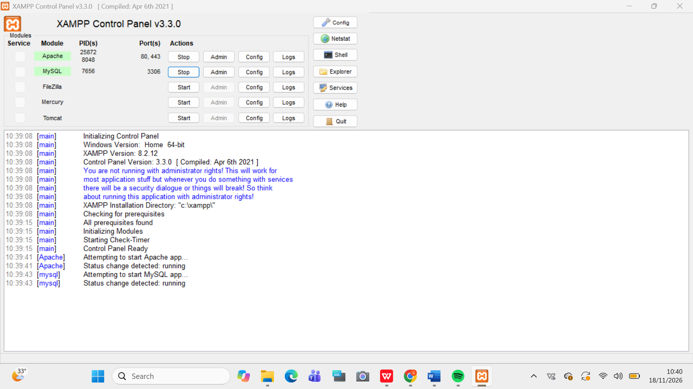

### Langkah 2 — Membuka phpMyAdmin

Buka browser dan akses `http://localhost/phpmyadmin/`.

**Penjelasan:** phpMyAdmin adalah aplikasi berbasis web untuk mengelola database MySQL.

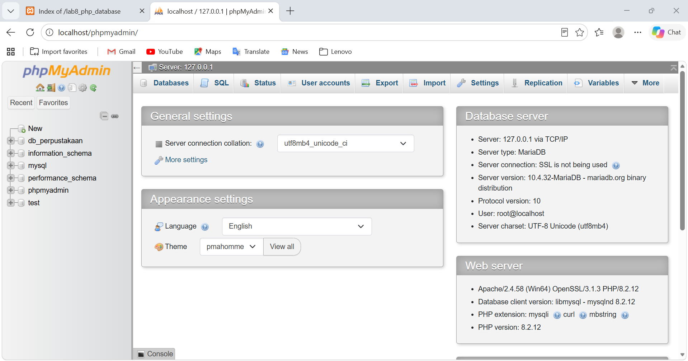

### Langkah 3 — Membuat Database

Pada tab **SQL** di phpMyAdmin, jalankan:

```sql
CREATE DATABASE latihan1;
```

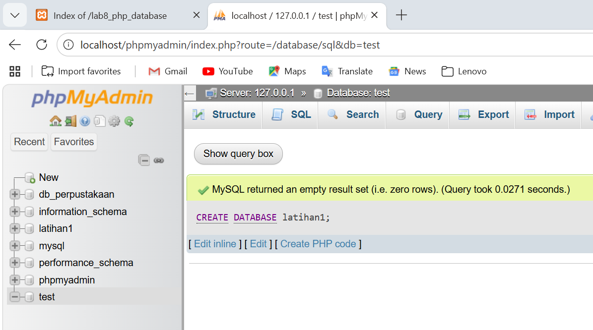

### Langkah 4 — Membuat Tabel `data_barang`

Pilih database `latihan1`, buka tab **SQL**, lalu jalankan:

```sql
CREATE TABLE data_barang (
  id_barang  INT(10) AUTO_INCREMENT PRIMARY KEY,
  kategori   VARCHAR(30),
  nama       VARCHAR(50),
  gambar     VARCHAR(100),
  harga_beli DECIMAL(10,0),
  harga_jual DECIMAL(10,0),
  stok       INT(4)
);
```

| Nama Field | Tipe Data | Ukuran | Keterangan |
|---|---|---|---|
| id_barang | INT | 10 | Primary Key, Auto Increment |
| kategori | VARCHAR | 30 | |
| nama | VARCHAR | 50 | |
| gambar | VARCHAR | 100 | |
| harga_beli | DECIMAL | 10 | |
| harga_jual | DECIMAL | 10 | |
| stok | INT | 4 | |

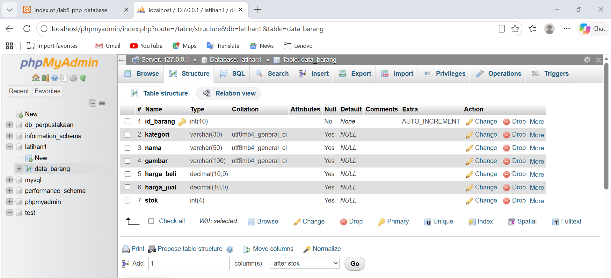

### Langkah 5 — Menambahkan Data Awal

```sql
INSERT INTO data_barang (kategori, nama, gambar, harga_beli, harga_jual, stok)
VALUES
('Elektronik', 'HP Samsung Android', 'hp_samsung.jpg', 2000000, 2400000, 5),
('Elektronik', 'HP Xiaomi Android',  'hp_xiaomi.jpg',  1000000, 1400000, 5),
('Elektronik', 'HP OPPO Android',    'hp_oppo.jpg',    1800000, 2300000, 5);
```

Cek dengan `SELECT * FROM data_barang;` atau tab **Telusuri**.

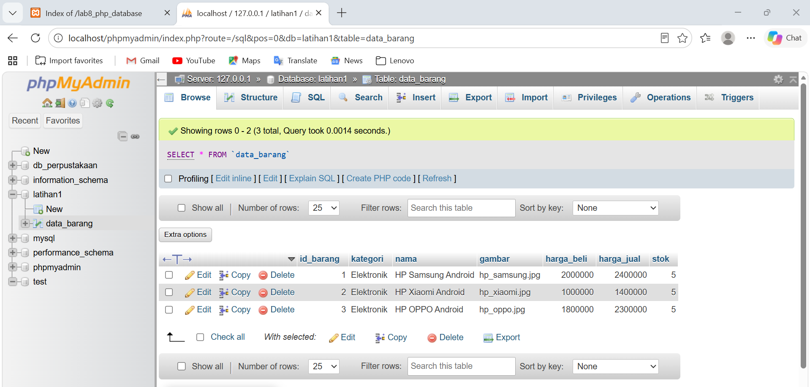

### Langkah 6 — Membuat Folder Project

1. Buat folder `lab8_php_database` di `C:\xampp\htdocs\` (atau `D:\xampp\htdocs\` sesuai instalasi).
2. Di dalamnya buat subfolder `gambar` dan letakkan file gambar contoh (`hp_samsung.jpg`, `hp_xiaomi.jpg`, `hp_oppo.jpg`).
3. Akses `http://localhost/lab8_php_database/`.

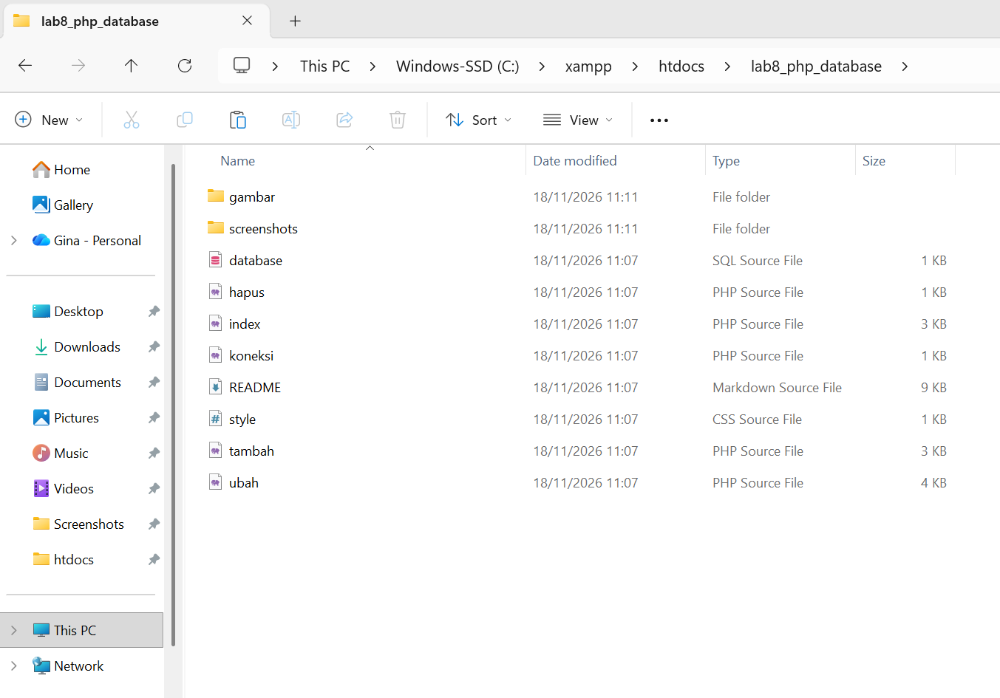
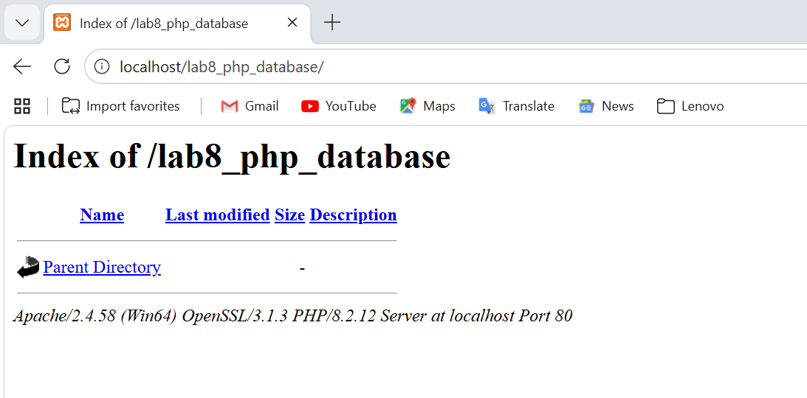

### Langkah 7 — Membuat `koneksi.php`

```php
<?php
$host = "localhost";
$user = "root";
$pass = "";
$db   = "latihan1";

$conn = mysqli_connect($host, $user, $pass, $db);
if ($conn == false) {
    echo "Koneksi ke server gagal: " . mysqli_connect_error();
    die();
}
mysqli_set_charset($conn, "utf8mb4");
#echo "Koneksi berhasil";
?>
```

**Penjelasan:**
- `mysqli_connect()` membuka koneksi ke MySQL dengan host, user, password, dan nama database.
- Jika gagal, program berhenti dengan `die()`.
- Untuk menguji, hapus tanda `#` pada `echo "Koneksi berhasil";`, buka `http://localhost/lab8_php_database/koneksi.php`, lalu **beri tanda `#` kembali** agar pesan tidak muncul di halaman lain.
- Fungsi `e()` (di file yang sama pada versi project ini) membungkus `htmlspecialchars()` untuk mencegah XSS.

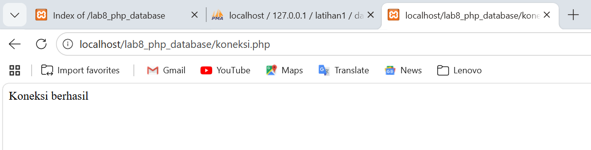

### Langkah 8 — READ: `index.php`

**Penjelasan:**
- `include("koneksi.php")` memuat koneksi.
- `SELECT * FROM data_barang` mengambil semua data.
- `mysqli_fetch_array()` di dalam `while` mengambil data baris demi baris untuk ditampilkan dalam tabel HTML.
- Kolom **Aksi** berisi link **Ubah** (`ubah.php?id=...`) dan **Hapus** (`hapus.php?id=...`).
- Link **Tambah Barang** mengarah ke `tambah.php`.

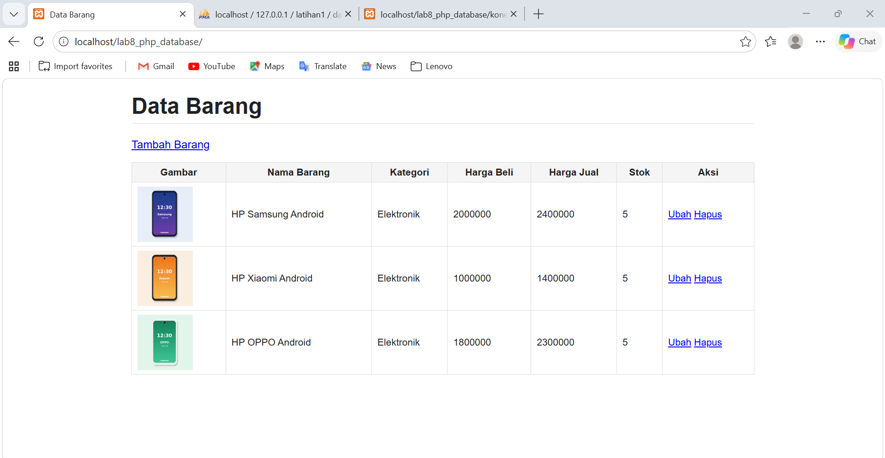

### Langkah 9 — CREATE: `tambah.php`

**Penjelasan:**
- Form memakai `method="post"` dan `enctype="multipart/form-data"` agar dapat mengunggah file.
- Saat tombol **Simpan** ditekan (`isset($_POST['submit'])`), data diambil dari `$_POST` dan file dari `$_FILES`.
- File gambar dipindahkan ke folder `gambar/` dengan `move_uploaded_file()`.
- Data disimpan dengan perintah `INSERT INTO` (memakai *prepared statement*), lalu halaman diarahkan ke `index.php`.

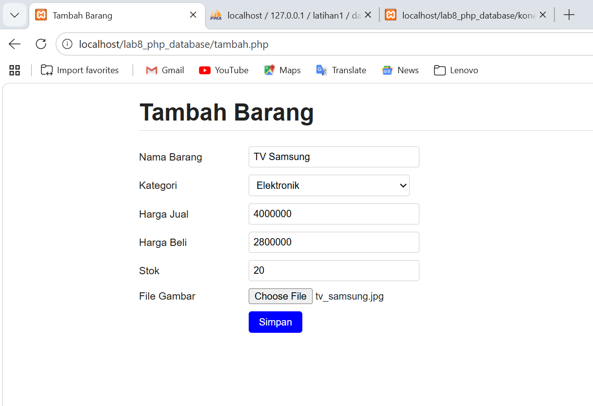
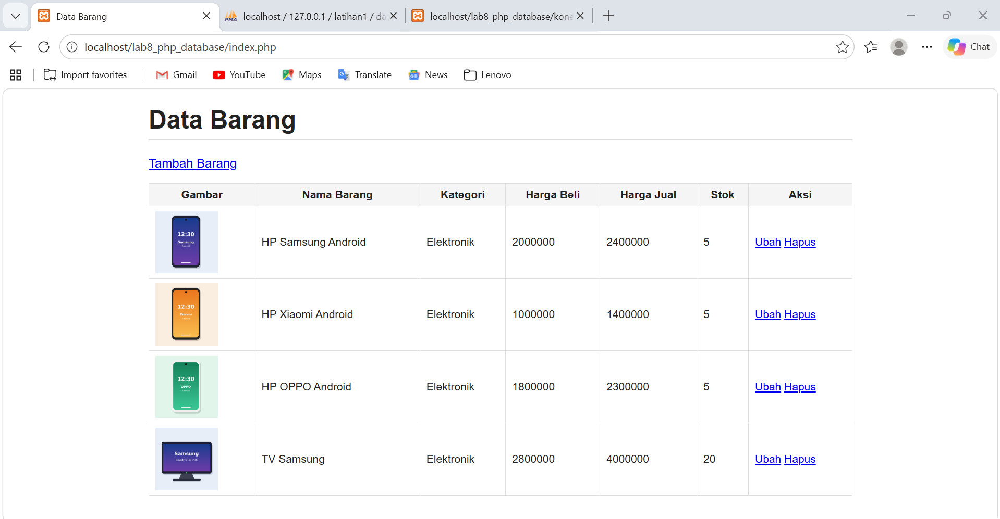

### Langkah 10 — UPDATE: `ubah.php`

**Penjelasan:**
- Data lama dibaca berdasarkan `id` dari URL (`$_GET['id']`) dan ditampilkan di form.
- `id_barang` dikirim lewat `<input type="hidden">`.
- Saat disimpan, dijalankan `UPDATE data_barang SET ... WHERE id_barang = ...`.
- Jika tidak ada gambar baru yang diunggah, kolom `gambar` tidak diubah.
- Fungsi `is_select()` memilih opsi kategori yang sesuai dengan data.

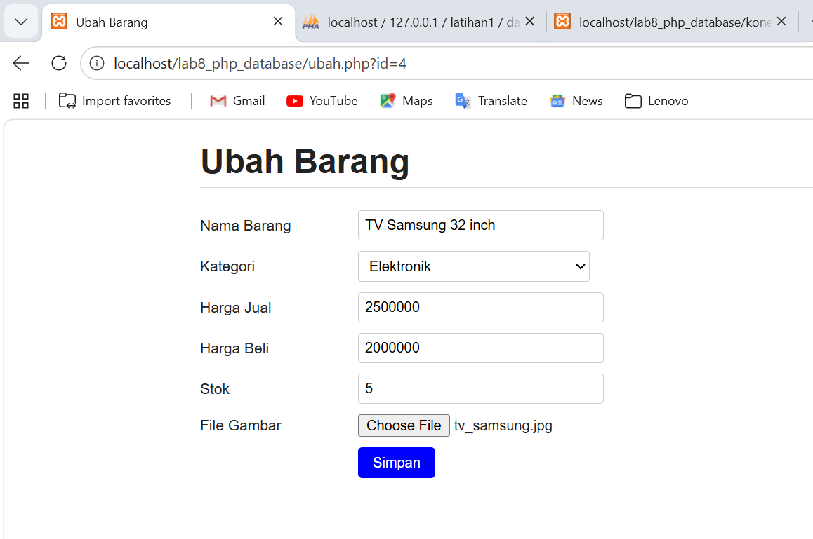
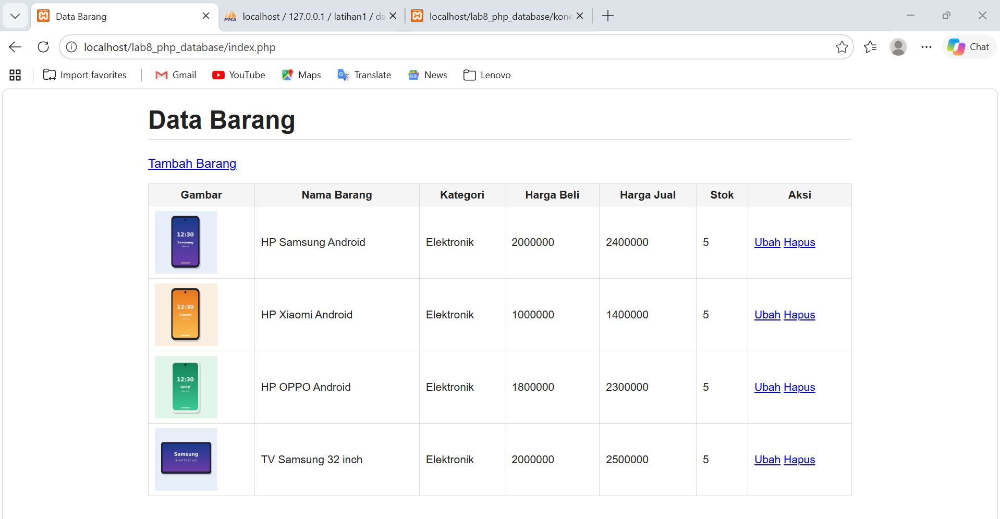

### Langkah 11 — DELETE: `hapus.php`

**Penjelasan:** Mengambil `id` dari URL lalu menjalankan `DELETE FROM data_barang WHERE id_barang = ...`. Di `index.php` ada konfirmasi `confirm()` sebelum data dihapus.

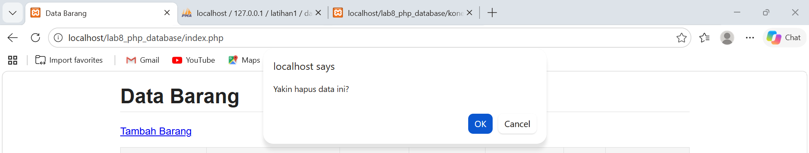
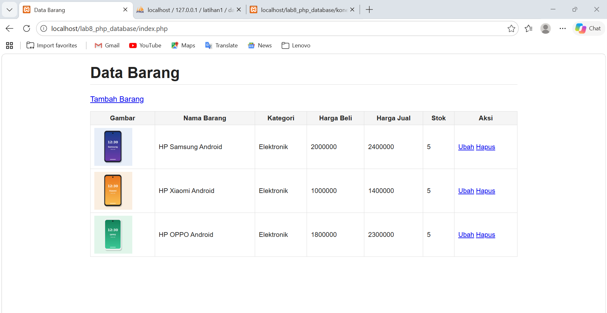

---

## 5. Perbaikan terhadap Kode Modul

Beberapa bagian kode di modul diperbaiki agar program benar-benar berjalan:

| # | Masalah pada modul | Perbaikan |
|---|---|---|
| 1 | `index.php` tidak memiliki link **Tambah Barang** dan **Ubah/Hapus**, padahal ada di gambar hasil | Ditambahkan |
| 2 | Urutan kolom header (Harga Jual, Harga Beli) terbalik dari isi data | Disamakan: Harga Beli, Harga Jual |
| 3 | Path gambar ganda (`gambar/gambar/...`) karena `tambah.php` menyimpan `gambar/nama.jpg` sedangkan `index.php` menambah `gambar/` lagi | Database hanya menyimpan nama file |
| 4 | `enctype="multipart/formdata"` di `ubah.php` (typo) membuat upload gagal | Diubah menjadi `multipart/form-data` |
| 5 | `is_select('Komputer', ...)` dipakai untuk semua opsi kategori | Setiap opsi memakai nilainya masing-masing |
| 6 | Query rentan **SQL Injection** karena variabel langsung disisipkan | Memakai *prepared statement* (`mysqli_prepare`) |
| 7 | Output belum di-escape | Memakai `htmlspecialchars()` melalui fungsi `e()` |
| 8 | Struktur tabel `nama` varchar(30) tetapi tabel desain 50 | Disamakan menjadi varchar(50) |
| 9 | `style.css` tidak disediakan | Dibuat |
| 10 | Upload tidak divalidasi | Dibatasi ekstensi gambar dan nama file diberi awalan `time()` |

## 6. Hasil Pengujian

| Fitur | Skenario | Hasil yang Diharapkan | Status |
|---|---|---|---|
| Koneksi | Buka `koneksi.php` | Muncul "Koneksi berhasil" | ✔ |
| Read | Buka `index.php` | Data barang tampil dalam tabel | ✔ |
| Create | Isi form tambah lalu Simpan | Data baru muncul di tabel | ✔ |
| Update | Klik Ubah, edit data, Simpan | Data berubah di tabel | ✔ |
| Delete | Klik Hapus lalu OK | Data hilang dari tabel | ✔ |

> Centang/ubah status sesuai hasil pengujian Anda sendiri.

## 7. Kesimpulan

Dengan praktikum ini, mahasiswa dapat membuat database MySQL, menghubungkannya dengan PHP menggunakan `mysqli`, dan membangun aplikasi CRUD sederhana. Operasi Create, Read, Update, dan Delete masing-masing dikerjakan oleh perintah SQL `INSERT`, `SELECT`, `UPDATE`, dan `DELETE`. Penggunaan *prepared statement* dan escape output penting untuk keamanan aplikasi.
